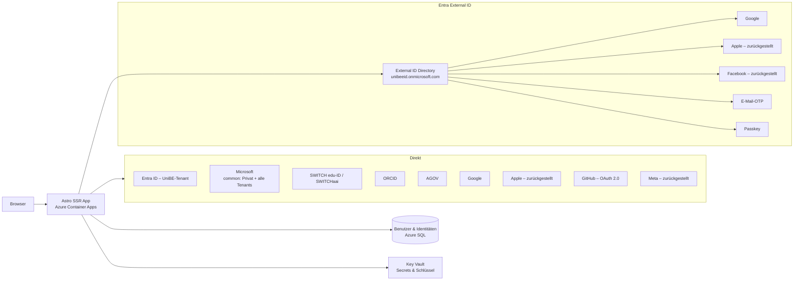
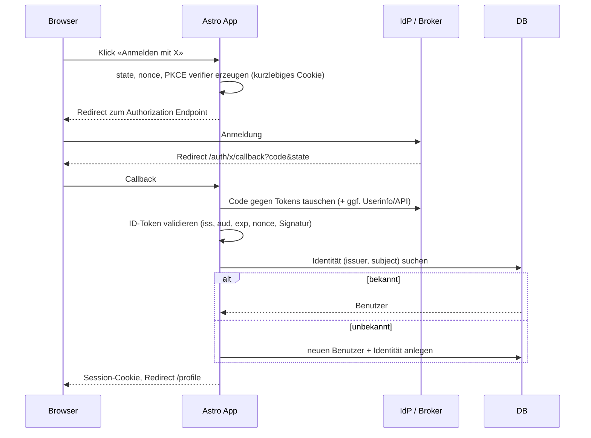

# 01 – Architektur

## Überblick

Die Applikation ist eine serverseitig gerenderte Astro-App. Sie ist selbst die *Relying Party* (RP) und spricht die Identity Provider auf **zwei Wegen** an, die bewusst beide gezeigt werden (siehe [ADR-003](02-decisions.md#adr-003-beide-anbindungswege-direkt-und-broker-zeigen)):

1. **Direkt:** Die App ist bei jedem IdP einzeln registriert und führt den Flow selbst durch.
2. **Broker:** Die App ist nur beim bestehenden **Entra External ID Directory** registriert; dieses föderiert seinerseits mit Social-IdPs, E-Mail-OTP und Passkeys.

## Komponenten

| Komponente | Aufgabe |
|---|---|
| **Login-Seite** (`/`) | Startseite. Zeigt alle Anmeldemethoden, gruppiert nach «Direkt» und «Über External ID». Passkey-Login als eigene Option. |
| **Auth-Routen** (`/auth/[provider]/login`, `/auth/[provider]/callback`) | Generischer Handler pro Provider: baut Authorization Request (PKCE, `state`, `nonce`), verarbeitet Callback, validiert Tokens bzw. holt Benutzerdaten. |
| **Provider-Registry** | Eine Konfiguration pro Provider (Typ `oidc` / `oauth2`, Discovery-URL oder Endpunkte, Scopes, Claim-Mapping, Identitätsschlüssel). Neue IdPs = neuer Eintrag. |
| **Profil** (`/profile`) | Zeigt Benutzerkonto, verbundene Accounts (mit Provider, Zeitpunkt, letzte Anmeldung, ausgewählte Claims) und Passkeys. Aktionen: verbinden, trennen. |
| **Linking-Routen** (`/link/[provider]`) | Wie Login, aber mit Intent `link` – das Ergebnis wird dem eingeloggten Benutzer zugeordnet (siehe [04](04-account-linking.md)). |
| **Passkey-Routen** (`/passkey/*`) | WebAuthn-Registrierung und -Anmeldung (SimpleWebAuthn). |
| **Session** | Server-seitige Session (ID im `HttpOnly`/`Secure`/`SameSite=Lax`-Cookie), Daten in der DB. |
| **Debug-/Lernansicht** | Optional ein- und ausklappbar: Rohclaims des ID-Tokens bzw. der Userinfo-Antwort, `amr`/`acr`, Issuer – zentral für den Demo-Zweck. Keine Tokens selbst anzeigen. |

## Ablauf Login (vereinfacht)

## Sicherheitsgrundsätze

- Authorization Code Flow mit **PKCE** für alle Provider; kein Implicit Flow.
- `state` und `nonce` immer prüfen; Transaktionsdaten in einem kurzlebigen, signierten Cookie.
- Identitäten werden **ausschliesslich über (Issuer, Subject)** identifiziert, nie über E-Mail (siehe [ADR-005](02-decisions.md)).
- Access-/Refresh-Tokens der IdPs werden nicht persistiert (die App braucht nach dem Login keinen API-Zugriff).
- Secrets und private Schlüssel (z. B. Apple-Key) liegen in Key Vault, Zugriff via Managed Identity.
