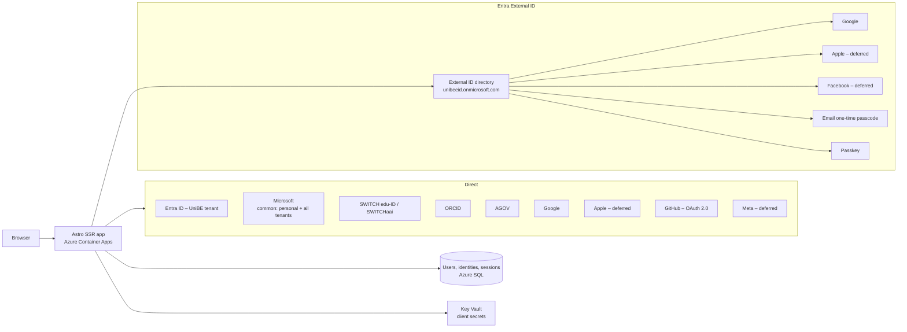
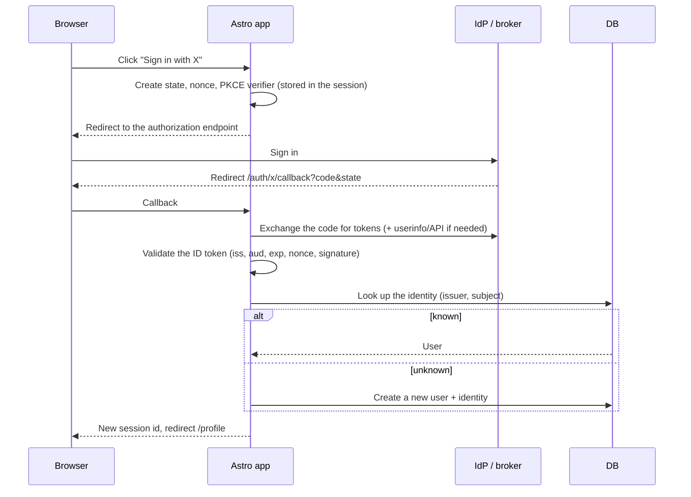

# 01 – Architecture

## Overview

The application is a server-rendered Astro app. It is itself the *relying party* (RP) and talks to the identity providers in **two ways**, both of which are shown deliberately (see [ADR-003](02-decisions.md#adr-003-show-both-connection-paths-direct-and-broker)):

1. **Direct:** the app is registered with each IdP individually and runs the flow itself.
2. **Broker:** the app is registered only with the existing **Entra External ID directory**, which in turn federates with social IdPs, email one-time passcodes and passkeys.

## Components

| Component | Purpose |
|---|---|
| **Sign-in page** (`/`) | Start page. Every sign-in method, grouped by audience: UniBE, universities & research, other accounts; passkey sign-in and "coming soon" ([ADR-017](02-decisions.md)). |
| **Guided sign-in** (`/choose?for=…`) | "Who are you?" → a recommended method plus alternatives. Plain links, no JavaScript. |
| **Preferences** (`/prefs?lang=…&theme=…&next=…`) | Sets the language (de/en) and theme (dark/light) cookies and returns to a same-site path. Dark is the default. |
| **UI strings** (`src/i18n/ui.ts`) | All visible text in German and English; flash messages are stored as keys so they render in the viewer's language. |
| **Auth routes** (`/auth/[provider]/login`, `/auth/[provider]/callback`) | One generic handler per provider: builds the authorization request (PKCE, `state`, `nonce`), processes the callback, validates tokens or fetches the user's data. |
| **Provider registry** (`src/lib/providers.ts`) | One definition per provider (type `oidc` / `oauth2`, issuer or endpoints, scopes, identity key). A new IdP is a new entry. |
| **Profile** (`/profile`) | Shows the user account, linked accounts (provider, linked at, last sign-in, selected claims) and later passkeys. Actions: link, unlink, delete account. |
| **Linking** (`/auth/[provider]/login?intent=link`) | Like sign-in, but the result is attached to the signed-in user (see [04](04-account-linking.md)). |
| **Passkey routes** (`/passkey/*`) | WebAuthn registration and sign-in (SimpleWebAuthn) – planned. |
| **Session** | Astro sessions with a driver on Azure SQL; the session id is in an `HttpOnly`, `Secure`, `SameSite=Lax` cookie. |
| **Technical details** | A collapsible view per linked account: issuer, subject and the selected claims – central to the demo's purpose. Tokens themselves are never shown. |

## Sign-in flow (simplified)

## Security principles

- Authorization code flow with **PKCE** for every provider; no implicit flow.
- `state` and `nonce` are always checked; the transaction lives in the server-side session and expires after 10 minutes.
- Identities are identified **only by (issuer, subject)**, never by email address (see [ADR-005](02-decisions.md)).
- The IdPs' access and refresh tokens are not persisted – the app needs no API access after sign-in.
- The session id is regenerated after every sign-in (session fixation).
- Form posts (sign-out, unlink, delete) are protected by Astro's origin check. Behind the Container Apps ingress, `security.allowedDomains` makes Astro trust `X-Forwarded-Host`/`-Proto` for the app's own hosts only.
- Client secrets live in Key Vault; the app reads them with its managed identity. Azure SQL accepts Entra sign-in only.
