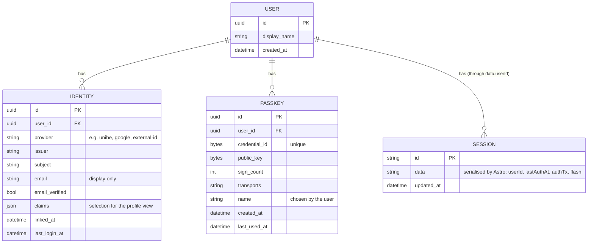
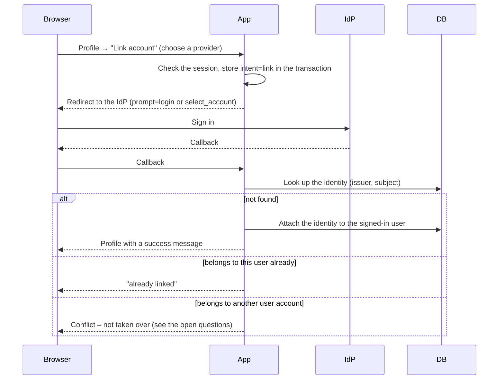

# 04 – User accounts and account linking

## Principles

- A **user account** can have any number of **identities** (linked accounts) and **passkeys**.
- An identity is unique by **(issuer, subject)** and belongs to exactly one user account.
- Linking happens **only by hand** and only with proof of ownership (signing in with the provider being linked) – no automatic merge ([ADR-005](02-decisions.md)).

## Data model

Uniqueness: `UNIQUE(issuer, subject)` on IDENTITY, `UNIQUE(credential_id)` on PASSKEY.

Implementation: `db/migrations/001_initial.sql` (USER, IDENTITY, SESSION); PASSKEY follows with the passkeys. Deleting a user deletes its identities through `ON DELETE CASCADE`.

`claims` holds only the claims the demo needs (data minimisation, see the open questions).

**Sessions:** the session table belongs to Astro. Its content is a serialised blob; Astro handles the expiry of individual values itself (TTL eight hours). The session driver deletes rows that have not been written for more than 24 hours, at most once an hour.

## Flows

### Sign-in

1. The callback yields a validated (issuer, subject).
2. The identity exists → sign the user in, update `last_login_at` and the claims.
3. The identity does not exist → create a **new** user account plus identity.

### Linking an account

- The intent is bound to `state` through the transaction in the server-side session.
- `prompt=login` / `select_account`, so the account already active at the IdP is not taken over by accident.

### Unlinking an account

- Allowed as long as at least **one way to sign in** (identity or passkey) remains. The SQL statement checks this atomically.
- Planned: re-authentication when the last sign-in is more than about ten minutes ago (`lastAuthAt` in the session).

### Deleting the account

- Deletes the user, its identities and – later – its passkeys, and ends the session. Sensible for a demo site (data protection, self-service).

## Passkeys

### The app's own passkeys (WebAuthn)

- **Registration:** only for signed-in users, in the profile ("Add passkey"). A passkey is therefore always bound to an existing account.
- **Sign-in:** a "Sign in with passkey" button on the sign-in page, discoverable credentials (resident keys) and conditional UI (autofill), `userVerification: required`.
- **RP id:** `login-example.campus.cloud` – passkeys are bound to this domain; test environments (e.g. `localhost`) need passkeys of their own.
- **Library:** `@simplewebauthn/server` and `@simplewebauthn/browser`.
- **Management:** list, rename and delete passkeys in the profile.

### Passkeys at the IdPs

- Entra (UniBE tenant), External ID, Google, Apple, Microsoft accounts and others support passkeys on their side.
- The app notices only through `amr`/`acr` (where sent) and shows it in the technical details. That makes the difference between "passkey at the app" and "passkey at the IdP" visible.
