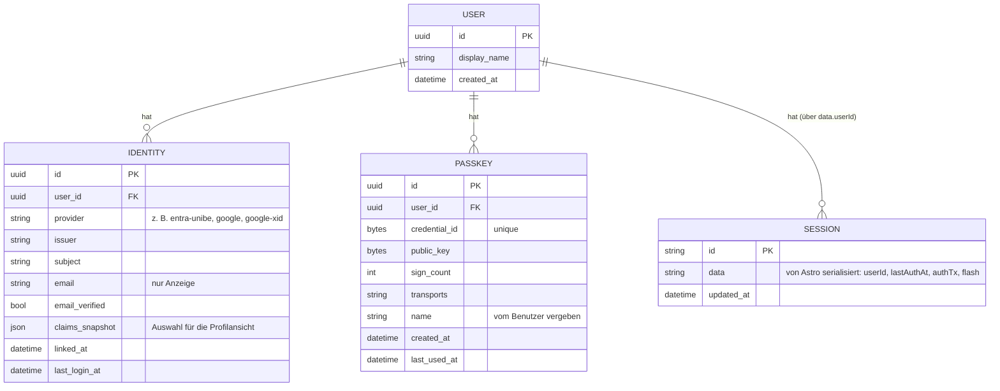
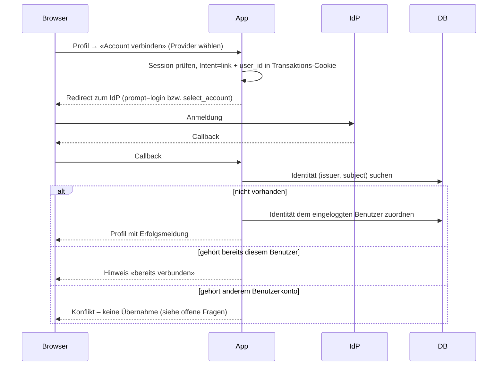

# 04 – Benutzerkonten und Account-Linking

## Grundsätze

- Ein **Benutzerkonto** (User) kann beliebig viele **Identitäten** (verbundene Accounts) und **Passkeys** haben.
- Eine Identität ist eindeutig über **(Issuer, Subject)** und gehört genau einem Benutzerkonto.
- Verknüpfen geschieht **nur manuell** und nur mit Besitznachweis (Anmeldung beim zu verbindenden Provider) – kein automatischer Merge ([ADR-005](02-decisions.md)).

## Datenmodell

Eindeutigkeit: `UNIQUE(issuer, subject)` auf IDENTITY, `UNIQUE(credential_id)` auf PASSKEY.

Umsetzung: `db/migrations/001_initial.sql` (USER, IDENTITY, SESSION); PASSKEY folgt mit den Passkeys. Identitäten werden beim Löschen eines Benutzers per `ON DELETE CASCADE` mitgelöscht.

**Sessions:** Die Session-Tabelle gehört Astro. Ihr Inhalt ist ein serialisierter Blob, den Ablauf einzelner Werte (TTL 8 Stunden) regelt Astro selbst. Zeilen, die länger als 24 Stunden nicht geschrieben wurden, löscht der Session-Treiber stündlich.

`claims_snapshot` speichert nur die für die Demo nötigen Claims (Datenminimierung, siehe offene Fragen).

## Abläufe

### Anmelden

1. Callback liefert validierte (Issuer, Subject).
2. Identität existiert → Benutzer einloggen, `last_login_at` aktualisieren.
3. Identität existiert nicht → **neues** Benutzerkonto plus Identität anlegen.

### Account verbinden

- Der Intent wird an `state` gebunden; die Session-User-ID im Callback muss mit der im Transaktions-Cookie übereinstimmen.
- `prompt=login` / `select_account`, damit nicht versehentlich der bereits aktive Account beim IdP übernommen wird.

### Account trennen

- Erlaubt, solange danach mindestens **eine Anmeldemöglichkeit** (Identität oder Passkey) übrig bleibt.
- Vorherige Re-Authentisierung, wenn die letzte Anmeldung länger als z. B. 10 Minuten zurückliegt (`last_auth_at`).

### Konto löschen

- Löscht Benutzer, Identitäten, Passkeys und Sessions. Für eine Demo-Seite sinnvoll (Datenschutz, Selbstbedienung).

## Passkeys

### App-eigene Passkeys (WebAuthn)

- **Registrierung:** nur für eingeloggte Benutzer:innen im Profil («Passkey hinzufügen»). Damit ist ein Passkey immer an ein bestehendes Konto gebunden.
- **Anmeldung:** Button «Mit Passkey anmelden» auf der Login-Seite, Discoverable Credentials (Resident Keys) und Conditional UI (Autofill), `userVerification: required`.
- **RP-ID:** `login-example.campus.cloud` – Passkeys sind an diese Domain gebunden; Testumgebungen (z. B. `localhost`) brauchen eigene Passkeys.
- **Bibliothek:** `@simplewebauthn/server` und `@simplewebauthn/browser`.
- **Verwaltung:** Passkeys im Profil auflisten, umbenennen, löschen.

### Passkeys bei den IdPs

- Entra (UniBE-Tenant), External ID, Google, Apple, Microsoft-Konten u. a. unterstützen Passkeys auf ihrer Seite.
- Die App erkennt das nur über `amr`/`acr` (soweit geliefert) und zeigt es in der Lernansicht an. So wird der Unterschied «Passkey bei der App» vs. «Passkey beim IdP» sichtbar.
